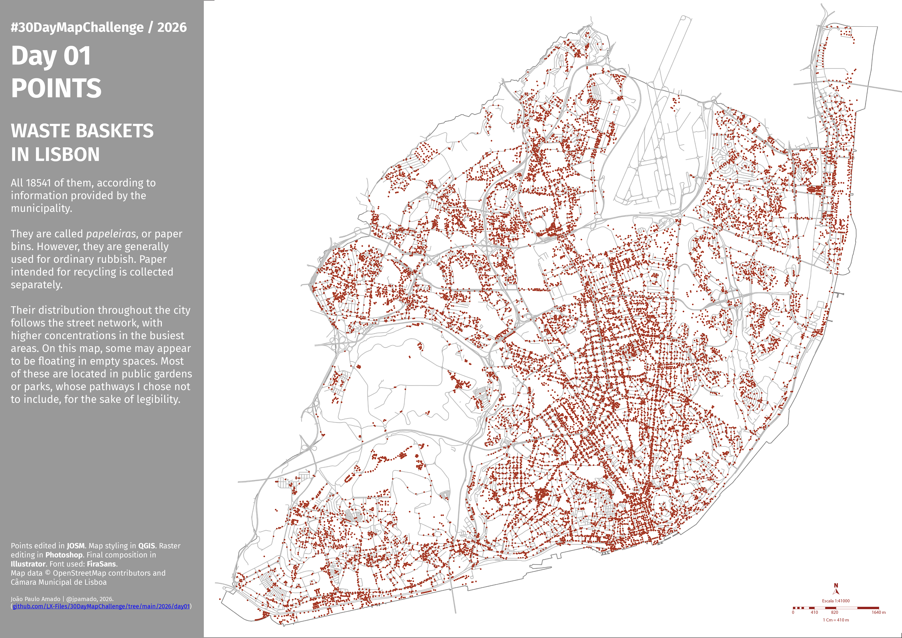

<h3>#30DayMapChallenge / 2026</h3>
<h1>DAY 01 - POINTS</h1>
<h2>WASTE BASKETS IN LISBON</h2> 

All 18541 of them, according to information provided by the municipality.

They are called papeleiras, or paper bins. However, they are generally used for ordinary rubbish. Paper intended for recycling is collected separately.

Their distribution throughout the city follows the street network, with higher concentrations in the busiest areas. On this map, some may appear to be floating in empty spaces. Most of these are located in public gardens or parks, whose pathways I chose not to include, for the sake of legibility.

Points edited in <b>#JOSM</b>. Map styling in <b>#QGIS</b>. Raster editing in <b>#Photoshop</b>. Final composition in <b>#Illustrator</b>. Font used: <b>FiraSans</b>. Map data  © OpenStreetMap contributors and C&acaret;mara Municipal de Lisboa.

File listing:

<ul>
<li><b>30daymapchallenge__2026-day01__points.png</b> - the MAP itself.</li>
<li><b>lx_municipality_contour.osm</b> - the contour line for the Lisbon municipality in 2025.</li>
<li><b>lx_municipality_highway_crossing.osm</b> - highway crossings inside Lisbon.</li>
<li><b>lx_municipality_highway_traffic-signals.osm</b> - traffic signals inside Lisbon.</li>
</ul>

João Paulo Amado | @jpamado, 2026.

&nbsp;

<table>
<tr>
<td style="border:thin #000">

</td>
</tr>
</table>
