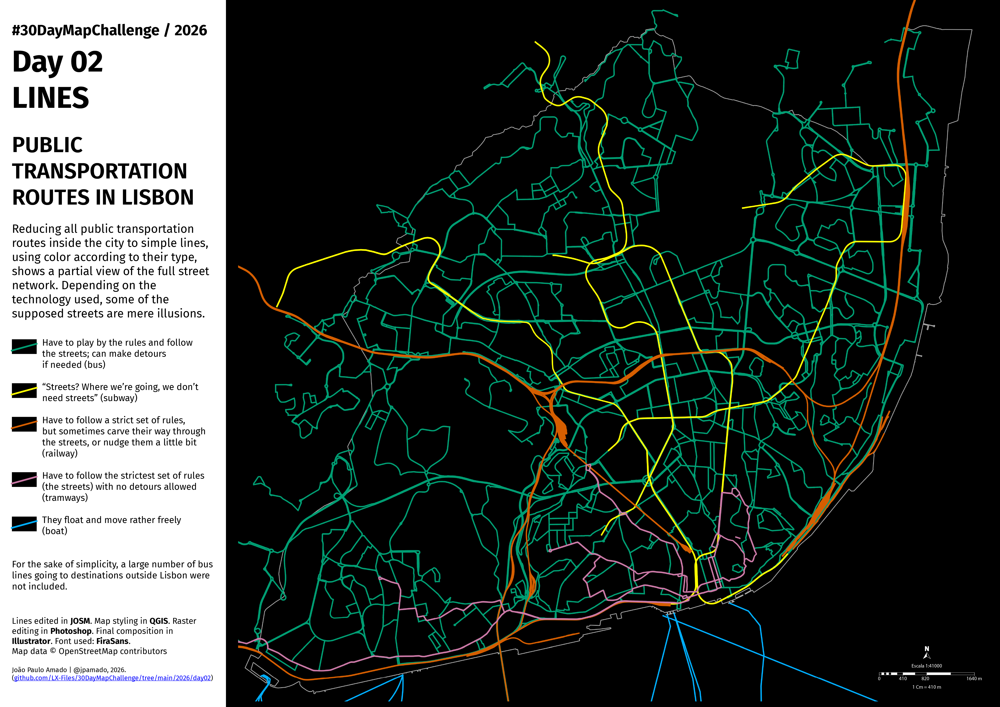

<h3>#30DayMapChallenge / 2026</h3>
<h1>DAY 02 - LINES</h1>
<h2>PUBLIC TRANSPORTATION ROUTES IN LISBON</h2> 

Reducing all public transportation routes inside the city to simple lines, using color according to their type, shows a partial view of the full street network. Depending on the technology used, some of the supposed streets are mere illusions

For the sake of simplicity, a large number of bus lines going to destinations outside Lisbon were not included.

The files provide a map view larger than the one shown here, since some of the routes reach the other margin of the Tagus river.

Lines edited in <b>#JOSM</b>. Map styling in <b>#QGIS</b>. Raster editing in <b>#Photoshop</b>. Final composition in <b>#Illustrator</b>. Font used: <b>FiraSans</b>. Map data  © OpenStreetMap contributors.

File listing:

<ul>
<li><b>30daymapchallenge__2026-day02__lines.png</b> - the MAP itself.</li>
<li><b>lisbon_municipality_contour.geojson</b> - the contour line for the Lisbon municipality in 2026.</li>
<li><b>southern_river_margin.geojson</b> - partial segments of the coastline on the southern side of the Tagus river.</li>
<li><b>urban_transports__boat.geojson</b> - boat routes connecting Lisbon to the southern side of the Tagus river.</li>
<li><b>urban_transports__bus.zip</b> - bus routes operated by the municipal public transportation company (Carris).</li>
<li><b>urban_transports__subway.geojson</b> - subway routes.</li>
<li><b>urban_transports__train.geojson</b> - train routes, all of them reaching locations outside Lisbon.</li>
<li><b>urban_transports__tramways.geojson</b> - the tramway network.</li>
</ul>

João Paulo Amado | @jpamado, 2026.

&nbsp;

<table>
<tr>
<td style="border:thin #000">

</td>
</tr>
</table>
