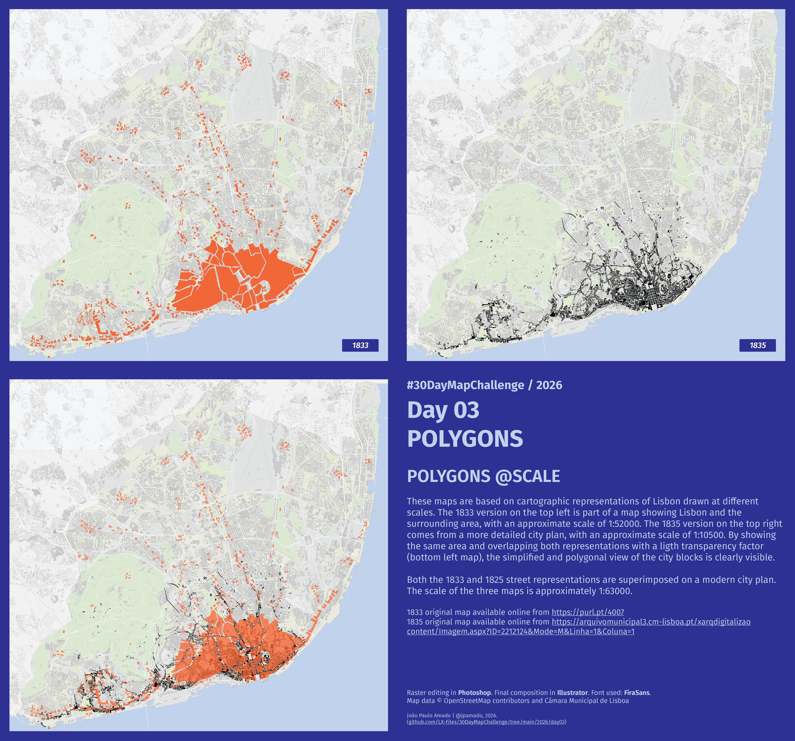

<h3>#30DayMapChallenge / 2026</h3>
<h1>DAY 03 - LINES</h1>
<h2>POLYGONS @SCALE</h2> 

These maps are based on cartographic representations of Lisbon drawn at different scales. The 1833 version on the top left is part of a map showing Lisbon and the surrounding area, with an approximate scale of 1:52000. The 1835 version on the top right comes from a more detailed city plan, with an approximate scale of 1:10500. By showing the same area and overlapping both representations with a ligth transparency factor (bottom left map), the simplified and polygonal view of the city blocks is clearly visible.

Both the 1833 and 1825 street representations are superimposed on a modern city plan. The scale of the three maps is approximately 1:63000.

1833 original map available online from <a href="https://purl.pt/4007">https://purl.pt/4007</a>

1835 original map available online from <a href="https://arquivomunicipal3.cm-lisboa.pt/xarqdigitalizacaocontent/PaginaDocumento.aspx?DocumentoID=257818&AplicacaoID=1&Pagina=1&Linha=1&Coluna=1">https://arquivomunicipal3.cm-lisboa.pt/xarqdigitalizacaocontent/PaginaDocumento.aspx?DocumentoID=257818&AplicacaoID=1&Pagina=1&Linha=1&Coluna=1</a>

Raster editing in <b>#Photoshop</b>. Final composition in <b>#Illustrator</b>. Font used: <b>FiraSans</b>. Map data  © OpenStreetMap contributors and C&acaret;mara Municipal de Lisboa

File listing:

<ul>
<li><b>30daymapchallenge__2026-day03__polygons.png</b> - the MAP itself.</li>
</ul>

João Paulo Amado | @jpamado, 2026.

&nbsp;

<table>
<tr>
<td style="border:thin #000">

</td>
</tr>
</table>
