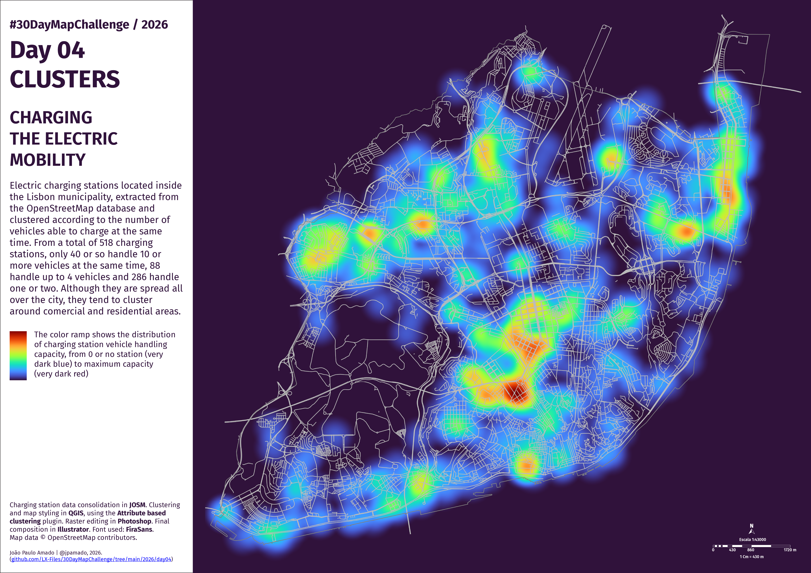

<h3>#30DayMapChallenge / 2026</h3>
<h1>DAY 04 - CLUSTERS</h1>
<h2>CHARGING THE ELECTRIC MOBILITY</h2> 

Electric charging stations located inside the Lisbon municipality, extracted from the OpenStreetMap database and clustered according to the number of vehicles able to charge at the same time. From a total of 518 charging stations, only 40 or so handle 10 or more vehicles at the same time, 88 handle up to 4 vehicles and 286 handle one or two. Although they are spread all over the city, they tend to cluster around comercial and residential areas.

Charging station data consolidation in <b>#JOSMz/b>. Clustering and map styling in <b>#QGIS</b>, using the <b>Attribute based clustering</b> plugin. Raster editing in <b>#Photoshop</b>. Final composition in <b>#Illustrator</b>. Font used: <b>FiraSans</b>.  
Map data  © OpenStreetMap contributors.

File listing:

<ul>
<li><b>30daymapchallenge__2026-day04__clusters.png</b> - the MAP itself.</li>
</ul>

João Paulo Amado | @jpamado, 2026.

&nbsp;

<table>
<tr>
<td style="border:thin #000">

</td>
</tr>
</table>
