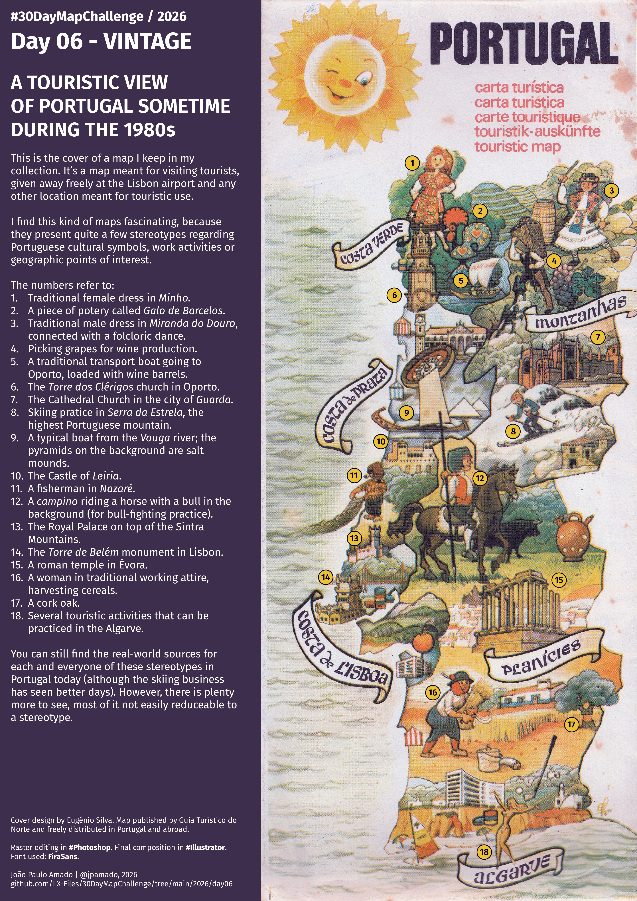

<h3>#30DayMapChallenge / 2026</h3>
<h1>DAY 06 - VINTAGE</h1>
<h2>A TOURISTIC VIEW OF PORTUGAL SOMETIME DURING THE 1980s</h2> 

This is the cover of a map I keep in my collection. It’s a map meant for visiting tourists, given away freely at the Lisbon airport and any other location meant for touristic use.

I find this kind of maps fascinating, because they present quite a few stereotypes regarding Portuguese cultural symbols, work activities or geographic points of interest.

The numbers refer to:

<ol><li>Traditional female dress in Minho.</li>
<li>A piece of potery called Galo de Barcelos.</li>
<li>Traditional male dress in Miranda do Douro, connected with a folcloric dance.</li>
<li>Picking grapes for wine production.</li>
<li>A traditional transport boat going to Oporto, loaded with wine barrels.</li>
<li>The Torre dos Clérigos church in Oporto.</li>
<li>The Cathedral Church in the city of Guarda.</li>
<li>Skiing pratice in Serra da Estrela, the highest Portuguese mountain.</li>
<li>A typical boat from the Vouga river; the pyramids on the background are salt mounds.</li>
<li>The Castle of Leiria.</li>
<li>A fisherman in Nazaré.</li>
<li>A campino riding a horse with a bull in the background (for bull-fighting practice).</li>
<li>The Royal Palace on top of the Sintra Mountains.</li>
<li>The Torre de Belém monument in Lisbon.</li>
<li>A roman temple in Évora.</li>
<li>A woman in traditional working attire, harvesting cereals.</li>
<li>A cork oak.</li>
<li>Several touristic activities that can be practiced in the Algarve.</li>
</ol>

Cover design by Eugénio Silva. Map published by Guia Turístico do Norte and freely distributed in Portugal and abroad.

Raster editing in <b>Photoshop</b>. Final composition in <b>Illustrator</b>. Font used: <b>FiraSans</b>.

João Paulo Amado | @jpamado, 2026.

File listing:

<ul>
<li><b>30daymapchallenge__2026-day06__vintage.png</b> - the MAP itself.</li>
</ul>

João Paulo Amado | @jpamado, 2026.

&nbsp;

<table>
<tr>
<td style="border:thin #000">

</td>
</tr>
</table>
