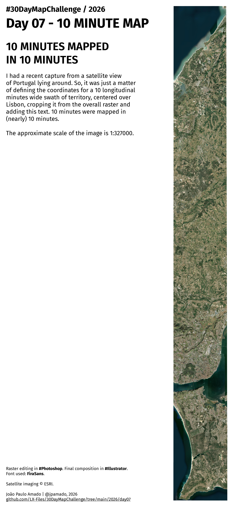

<h3>#30DayMapChallenge / 2026</h3>
<h1>DAY 07 - 10 MINUTE MAP</h1>
<h2>10 MINUTES MAPPED IN 10 MINUTES</h2> 

I had a recent capture from a satellite view of Portugal lying around. So, it was just a matter of defining the coordinates for a 10 longitudinal minutes wide swath of territory, centered over Lisbon, cropping it from the overall raster and adding this text. 10 minutes were mapped in (nearly) 10 minutes.

The approximate scale of the image is 1:327000.

Raster editing in <b>Photoshop</b>. Final composition in <b>Illustrator</b>. Font used: <b>FiraSans</b>. Satellite imaging © ESRI

João Paulo Amado | @jpamado, 2026.

File listing:

<ul>
<li><b>30daymapchallenge__2026-day07__10_minute_map.png</b> - the MAP itself.</li>
</ul>

João Paulo Amado | @jpamado, 2026.

&nbsp;

<table>
<tr>
<td style="border:thin #000">

</td>
</tr>
</table>
