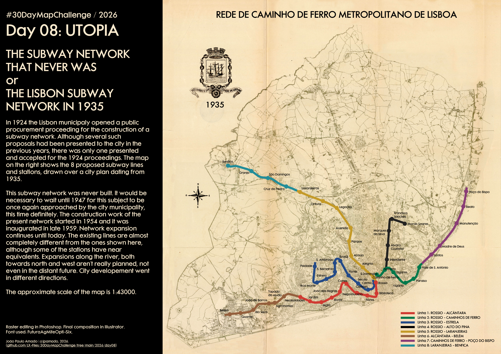

<h3>#30DayMapChallenge / 2026</h3>
<h1>DAY 08 - UTOPIA</h1>
<h2>THE SUBWAY NETWORK THAT NEVER WAS or THE LISBON SUBWAY NETWORK IN 1935</h2> 

In 1924 the Lisbon municipaly opened a public procurement proceeding for the construction of a subway network in Lisbon. Although the previous years had seen a number of proposals for such networks spontaneously presented, there was only one presented and accepted for the 1924 proceedings. The city plan on the right shows the 8 proposed subway lines and stations, drawn over a city plan dating from 1935.

This subway network was never built. It would be necessary to wait until 1947 for this subject to be once again approached by the city municipality, this time definitely. The construction work of the present network started in 1954 and it was inaugurated in late 1959. Network expansion continues until today. The existing lines are almost completely different from the ones shown here, although some of the stations have near equivalents. Expansions along the river, both towards north and west aren't really planned, not even in the distant future. City developement went in different directions.

The approximate scale of the map is 1:43000.

Raster editing in <b>Photoshop</b>. Final composition in <b>Illustrator</b>. Font used: <b>FuturaAgMiteOpti-Six</b>.

João Paulo Amado | @jpamado, 2026.

File listing:

<ul>
<li><b>30daymapchallenge__2026-day08__utopia.png</b> - the MAP itself.</li>
</ul>

João Paulo Amado | @jpamado, 2026.

&nbsp;

<table>
<tr>
<td style="border:thin #000">

</td>
</tr>
</table>
