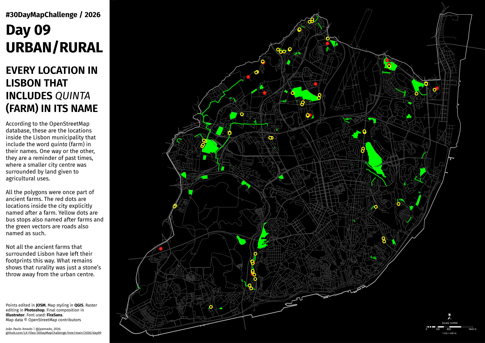

<h3>#30DayMapChallenge / 2026</h3>
<h1>DAY 09 - URBAN/RURAL</h1>
<h2>EVERY LOCATION IN LISBON THAT INCLUDES <i>QUINTA</i> (FARM) IN ITS NAME</h2> 

According to the OpenStreetMap database, these are the locations inside the Lisbon municipality that include the word <i>quinta</i> (farm) in their names. One way or the other, they are a reminder of past times, where a smaller city centre was surrounded by land given to agricultural uses.

All the polygons were once part of ancient farms. The red dots are locations inside the city explicitly named after a farm. Yellow dots are bus stops also named after farms and the green vectors are roads also named as such.

Not all the ancient farms that surrounded Lisbon have left their footprints this way. What remains shows that rurality was just a stone’s throw away from the urban centre.

Points edited in <b>#JOSM</b>. Map styling in <b>#QGIS</b>. Raster editing in <b>#Photoshop</b>. Final composition in <b>#Illustrator</b>. Font used: <b>FiraSans</b>. Map data  © OpenStreetMap contributors.

João Paulo Amado | @jpamado, 2026.

File listing:

<ul>
<li><b>30daymapchallenge__2026-day09__urban-rural.png</b> - the MAP itself.</li>
</ul>

João Paulo Amado | @jpamado, 2026.

&nbsp;

<table>
<tr>
<td style="border:thin #000">

</td>
</tr>
</table>
