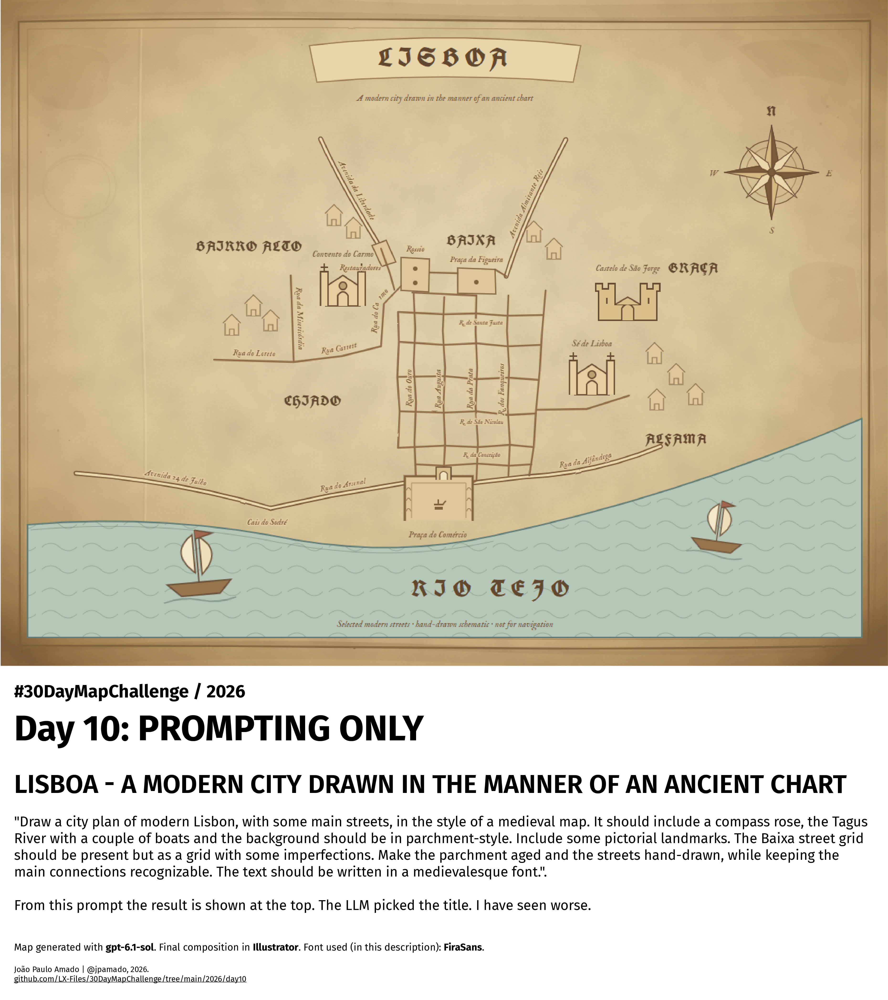

<h3>#30DayMapChallenge / 2026</h3>
<h1>DAY 10 - PROMPTING ONLY</h1>
<h2>LISBOA - A MODERN CITY DRAWN IN THE MANNER OF AN ANCIENT CHART</h2> 

"Draw a city plan of modern Lisbon, with some main streets, in the style of a medieval map. It should include a compass rose, the Tagus River with a couple of boats and the background should be in parchment-style. Include some pictorial landmarks. The Baixa street grid should be present but as a grid with some imperfections.
Make the parchment aged and the streets hand-drawn, while keeping the main connections recognizable. The text should be written in a medievalesque font."

From the above prompt the result is shown below. The LLM picked the title. I have seen worse.

The map is a raster image captured from the SVG output provided by the LLM.

Map generated with <b>gpt-6.1-sol</b>. Final composition in <b>#Illustrator</b>. Font used: <b>FiraSans</b>. Map data  © OpenStreetMap contributors.

João Paulo Amado | @jpamado, 2026.

File listing:

<ul>
<li><b>30daymapchallenge__2026-day10__prompting-only.png</b> - the MAP itself.</li>
<li><b>lisbon-medieval-style-v7.svg</b> - the SVG source file for this 'map'.</li>
</ul>

João Paulo Amado | @jpamado, 2026.

&nbsp;

<table>
<tr>
<td style="border:thin #000">

</td>
</tr>
</table>
