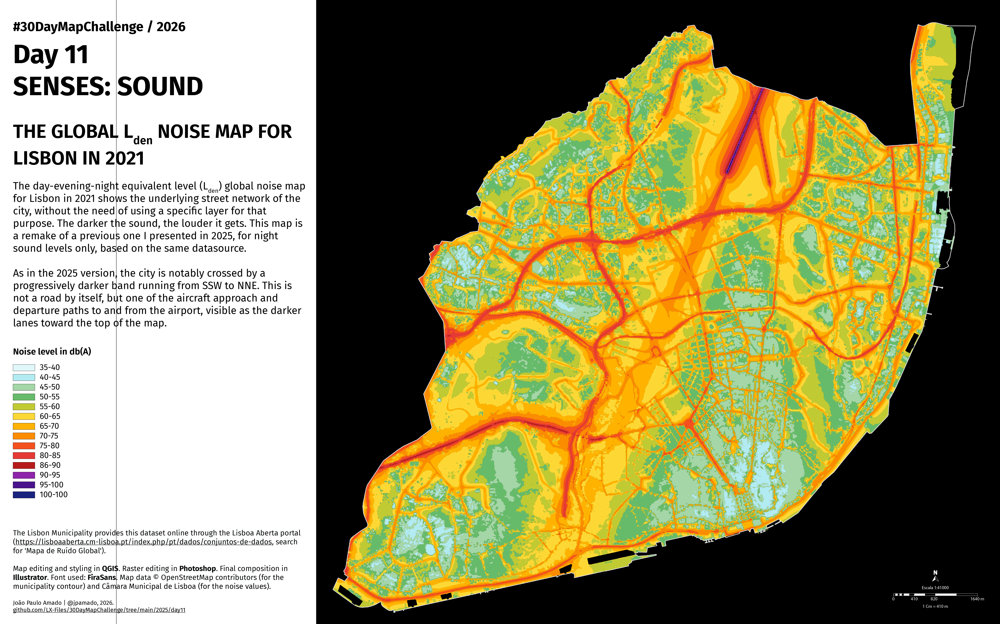

<h3>#30DayMapChallenge / 2026</h3>
<h1>DAY 11 - SENSES: SOUND</h1>
<h2>THE GLOBAL Lden NOISE MAP FOR LISBON IN 2021</h2> 

The day-evening-night equivalent level (Lden) global noise map for Lisbon in 2021 shows the underlying street network of the city, without the need of using a specific layer for that purpose. The darker the sound, the louder it gets. This map is a remake of a previous one I presented in 2025, for night sound levels only, based on the same datasource.

As in the 2025 version, the city is notably crossed by a progressively darker band running from SSW to NNE. This is not a road by itself, but one of the aircraft approach and departure paths to and from the airport, visible as the darker lanes toward the top of the map.

Map editing and styling in QGIS. Raster editing in <b>Photoshop</b>. Final composition in <b>Illustrator</b>. Font used: <b>FiraSans</b>. Map data © OpenStreetMap contributors (for the municipality contour) and Câmara Municipal de Lisboa (for the noise values).

File listing:

<ul>
<li><b>30daymapchallenge__2026-day11__senses-sound.png</b> - the MAP itself.</li>
</ul>

João Paulo Amado | @jpamado, 2026.

&nbsp;

<table>
<tr>
<td style="border:thin #000">

</td>
</tr>
</table>
