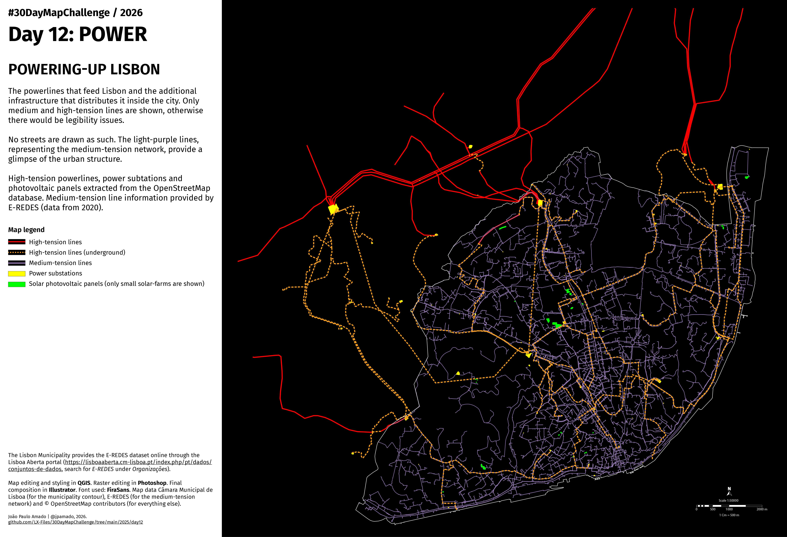

<h3>#30DayMapChallenge / 2026</h3>
<h1>DAY 12 - POWER</h1>
<h2>POWERING-UP LISBON</h2> 

The powerlines that feed Lisbon and the additional infrastructure that distributes it inside the city. Only medium and high-tension lines are shown, otherwise there would be legibility issues.

No streets are drawn as such. The light-purple lines, representing the medium-tension network, provide a glimpse of the urban structure.

High-tension powerlines, power subtations and photovoltaic panels extracted from the OpenStreetMap database. Medium-tension line information provided by E-REDES (data from 2020).

The Lisbon Municipality provides the E-REDES dataset online through the Lisboa Aberta portal (<a href=https://lisboaaberta.cm-lisboa.pt/index.php/pt/dados/
conjuntos-de-dados>https://lisboaaberta.cm-lisboa.pt/index.php/pt/dados/conjuntos-de-dados</a>, search for <i>E-REDES</i> under <i>Organizações</i>).

Map editing and styling in <b>QGIS</b>. Raster editing in <b>Photoshop</b>. Final composition in <b>Illustrator</b>. Font used: <b>FiraSans</b>. Map data Câmara Municipal de Lisboa (for the municipality contour), E-REDES (for the medium-tension network) and © OpenStreetMap contributors (for everything else).

File listing:

<ul>
<li><b>30daymapchallenge__2026-day12__power.png</b> - the MAP itself.</li>
<li><b>power_line.geojson</b> - high-tension powerlines.</li>
<li><b>power_solar.geojson</b> - solar photovoltaic farms.</li>
<li><b>power_substation.geojson</b> - power substations.</li>
<li><b>power_underground.geojson</b> - underground high-tension powerlines.</li>
</ul>

João Paulo Amado | @jpamado, 2026.

&nbsp;

<table>
<tr>
<td style="border:thin #000">

</td>
</tr>
</table>
