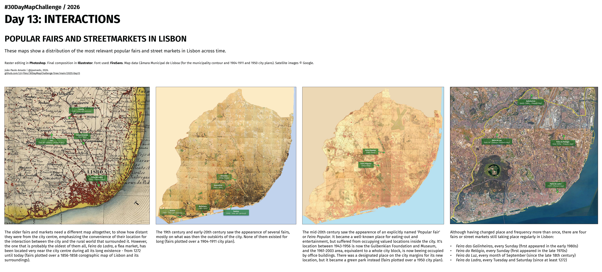

<h3>#30DayMapChallenge / 2026</h3>
<h1>DAY 13 - INTERACTIONS</h1>
<h2>POPULAR FAIRS AND STREETMARKETS IN LISBON</h2> 

These maps show a distribution of the most relevant popular fairs and street markets in Lisbon across the ages.

Raster editing in <b>Photoshop</b>. Final composition in <b>Illustrator</b>. Font used: <b>FiraSans</b>. Map data Câmara Municipal de Lisboa (for the municipality contour and 1904-1911 and 1950 city plans). Satellite images © Google.

File listing:

<ul>
<li><b>30daymapchallenge__2026-day13__interactions.png</b> - the MAP itself.</li>
</ul>

João Paulo Amado | @jpamado, 2026.

&nbsp;

<table>
<tr>
<td style="border:thin #000">

</td>
</tr>
</table>
