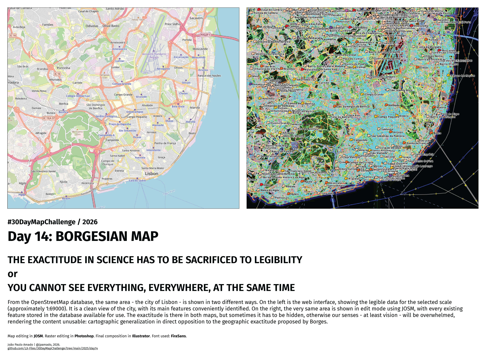

<h3>#30DayMapChallenge / 2026</h3>
<h1>DAY 14 - BORGESIAN MAP</h1>
<h2>THE EXACTITUDE IN SCIENCE HAS TO BE SACRIFICED TO LEGIBILITY 
or 
YOU CANNOT SEE EVERYTHING, EVERYWHERE, AT THE SAME TIME</h2> 

From the OpenStreetMap database, the same area - the city of Lisbon - is shown in two different ways. On the left is the web interface, showing the legible data for the selected scale (approximately 1:69000). It is a clean view of the city, with its main features conveniently identified. On the right, the very same area is shown in edit mode using JOSM, with every existing feature stored in the database available for use. The exactitude is there in both maps, but sometimes it has to be hidden, otherwise our senses - at least vision - will be overwhelmed, rendering the content unusable: cartographic generalization in direct opposition to the geographic exactitude proposed by Borges.

Map editing in <b>JOSM</b>. Raster editing in <b>Photoshop</b>. Final composition in <b>Illustrator</b>. Font used: <b>FiraSans</b>.

File listing:

<ul>
<li><b>30daymapchallenge__2026-day14__borgesian-map.png</b> - the MAP itself.</li>
</ul>

João Paulo Amado | @jpamado, 2026.

&nbsp;

<table>
<tr>
<td style="border:thin #000">

</td>
</tr>
</table>
