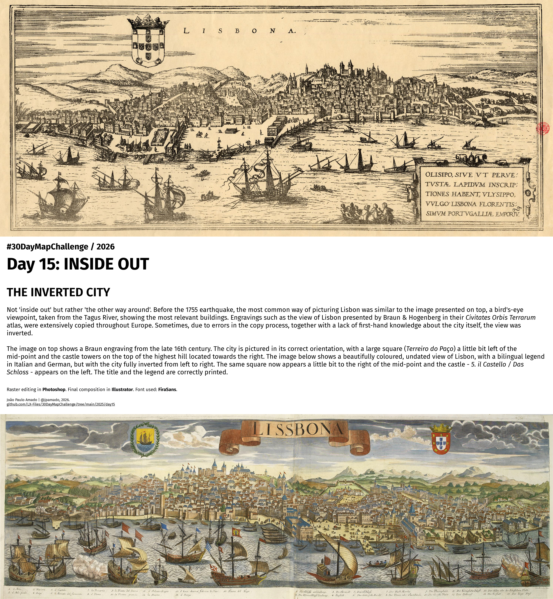

<h3>#30DayMapChallenge / 2026</h3>
<h1>DAY 15 - INSIDE OUT</h1>
<h2>THE INVERTED CITY</h2>

Not 'inside out' but rather 'the other way around'. Before the 1755 earthquake, the most common way of picturing Lisbon was similar to the views presented on top, a bird's-eye viewpoint, taken from the Tagus River, showing the most relevant buildings. Engravings such as the view of Lisbon presented by Braun & Hogenberg in their <i>Civitates Orbis Terrarum</i> atlas, were extensively copied throughout Europe. Sometimes, due to errors in the copy process, together with a lack of first-hand knowledge about the city itself, the view was inverted.

The image on top shows a Braun engraving from the late 16th century. The city is pictured in its correct orientation, with a large square (<i>Terreiro do Paço</i>) a little bit left of the mid-point and the castle towers on the top of the highest hill located towards the right. The image below shows a beautifully coloured, undated view of Lisbon, with a bilingual legend in Italian and German, with the city fully inverted from left to right. The same square now appears a little bit to the right of the mid-point and the castle - <i>5. il Castello / Das Schloss</i> - appears on the left. The title and the legend are correctly printed.

Raster editing in <b>Photoshop</b>. Final composition in <b>Illustrator</b>. Font used: <b>FiraSans</b>.

File listing:

<ul>
<li><b>30daymapchallenge__2026-day15__inside-out.jpg</b> - the MAP itself.</li>
</ul>

João Paulo Amado | @jpamado, 2026.

&nbsp;

<table>
<tr>
<td style="border:thin #000">

</td>
</tr>
</table>
