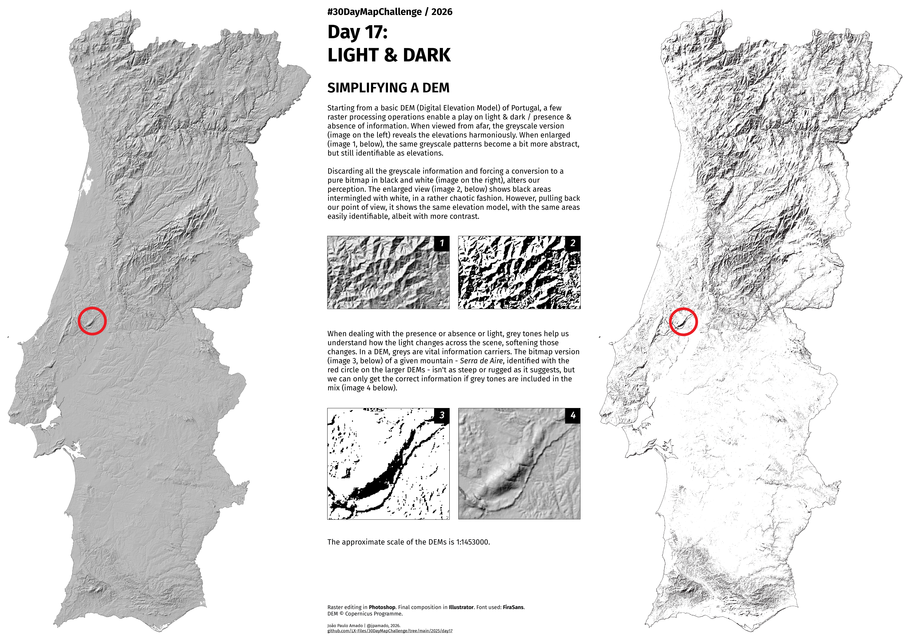

<h3>#30DayMapChallenge / 2026</h3>
<h1>DAY 17 - LIGHT & DARK</h1>
<h2>SIMPLIFYING A DEM</h2>

Starting from a basic DEM (Digital Elevation Model) of Portugal, a few raster processing operations enable a play on light & dark / presence & absence of information. When viewed from afar, the greyscale version (DEM on the left) reveals the elevations harmoniously. When enlarged (image 1), the same greyscale patterns become a bit more abstract, but still identifiable as elevations.

Discarding all the greyscale information and forcing a conversion to a pure bitmap in black and white (DEM on the right), alters our perception. The enlarged view (image 2) shows black areas intermingled with white, in a rather chaotic fashion. However, pulling back our point of view, it shows the same elevation model, with the same areas easily identifiable, albeit with more contrast.

When dealing with the presence or absence or light, grey tones help us understand how the light changes across the scene, softening those changes. In a DEM, greys are vital information carriers. The bitmap version (image 3) of a given mountain - Serra de Aire, identified with the red circle on the larger DEMs - isn't as steep or rugged as it suggests, but we can only get the correct information if grey tones are included in the mix (image 4).

The approximate scale of the DEMs is 1:1453000.

Raster editing in <b>Photoshop</b>. Final composition in <b>Illustrator</b>. Font used: <b>FiraSans</b>. 
DEM © Copernicus Programme.

File listing:

<ul>
<li><b>30daymapchallenge__2026-day-17__light-and-dark.jpg</b> - the MAP itself.</li>
</ul>

João Paulo Amado | @jpamado, 2026.

&nbsp;

<table>
<tr>
<td style="border:thin #000">

</td>
</tr>
</table>
