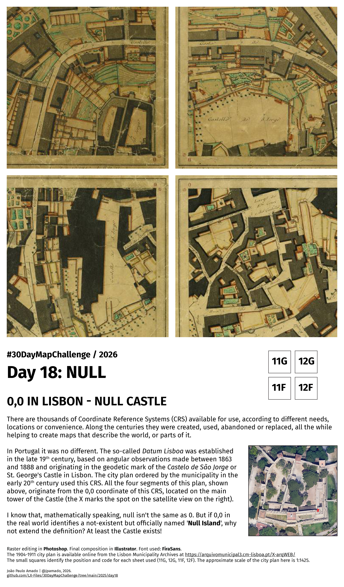

<h3>#30DayMapChallenge / 2026</h3>
<h1>DAY 18 - NULL</h1>
<h2>0,0 IN LISBON - NULL CASTLE</h2>

There are thousands of Coordinate Reference Systems (CRS) available for use, according to different needs, locations or convenience. Along the centuries they were created, used, abandoned or replaced, all the while helping to create maps that describe the world, or parts of it.

In Portugal it was no different. The so-called <i>Datum Lisboa</i> was established in the late 19th century, based on angular observations made between 1863 and 1888 and originating in the geodetic mark of the <i>Castelo de São Jorge</i> or St. George's Castle in Lisbon. The city plan ordered by the municipality in the early 20th century used this CRS. All the four segments of this plan, shown above, originate from the 0,0 coordinate of this CRS, located on the main tower of the Castle (the X marks the spot on the satellite view on the right)

I know that, mathematically speaking, null isn't the same as 0. But if 0,0 in the real world identifies a not-existent but officially named 'Null Island', why not extend the definition? At least the Castle exists!

The approximate scale of the DEMs is 1:1453000.

Raster editing in <b>Photoshop</b>. Final composition in <b>Illustrator</b>. Font used: <b>FiraSans</b>.

The 1904-1911 city plan is available from the Lisbon Municipality Archives at <a href="https://arquivomunicipal3.cm-lisboa.pt/X-arqWEB/">https://arquivomunicipal3.cm-lisboa.pt/X-arqWEB/</a>. The approximate scale of the city plan here is 1:1425.

<ul>
<li><a href="https://arquivomunicipal3.cm-lisboa.pt/xarqdigitalizacaocontent/PaginaDocumento.aspx?DocumentoID=242752&AplicacaoID=1&Pagina=1&Linha=1&Coluna=1">Sheet 11F</a></li>
<li><a href="https://arquivomunicipal3.cm-lisboa.pt/xarqdigitalizacaocontent/PaginaDocumento.aspx?DocumentoID=242753&AplicacaoID=1&Pagina=1&Linha=1&Coluna=1">Sheet 12F</a></li>
<li><a href="https://arquivomunicipal3.cm-lisboa.pt/xarqdigitalizacaocontent/PaginaDocumento.aspx?DocumentoID=242764&AplicacaoID=1&Pagina=1&Linha=1&Coluna=1">Sheet 11G</a></li>
<li><a href="https://arquivomunicipal3.cm-lisboa.pt/xarqdigitalizacaocontent/PaginaDocumento.aspx?DocumentoID=242765&AplicacaoID=1&Pagina=1&Linha=1&Coluna=1">Sheet 12G</a></li>
</ul>

File listing:

<ul>
<li><b>30daymapchallenge__2026-day-18__null.png</b> - the MAP itself.</li>
</ul>

João Paulo Amado | @jpamado, 2026.

&nbsp;

<table>
<tr>
<td style="border:thin #000">

</td>
</tr>
</table>
