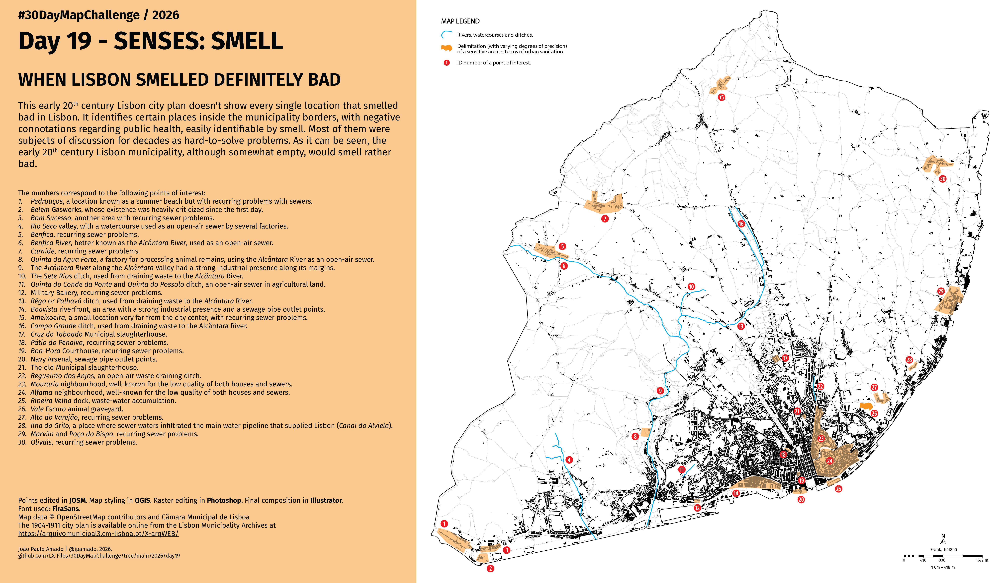

<h3>#30DayMapChallenge / 2026</h3>
<h1>DAY 19 - SENSES: SMELL</h1>
<h2>WHEN LISBON SMELLED DEFINITELY BAD</h2>

This early 20th century Lisbon city plan doesn't show every single location that smelled bad in Lisbon. It identifies certain places inside the municipality borders, with negative connotations regarding public health, easily identifiable by smell. Most of them were subjects of discussion for decades as hard-to-solve problems. As it can be seen, the early 20th century Lisbon municipality, although somewhat empty, would smell rather bad.

The numbers correspond to the following locations:

<ol>
<li><i>Pedrouços</i>, a location known as a summer beach but with recurring problems with sewers.</li>
<li><i>Belém</i> Gasworks, whose existence was heavily criticized since the first day.</li>
<li><i>Bom Sucesso</i>, another area with recurring sewer problems.</li>
<li><i>Rio Seco</i> valley, with a watercourse used as an open-air sewer by several factories.</li>
<li><i>Benfica</i>, recurring sewer problems.</li>
<li><i>Benfica</i> River, better known as the <i>Alcântara</i> River, used as an open-air sewer both by factories and the general population.</li>
<li><i>Carnide</i>, recurring sewer problems.</li>
<li><i>Quinta da Água Forte</i>, a factory for processing animal remains, using the <i>Alcântara</i> River as an open-air sewer.</li>
<li>The <i>Alcântara</i> River along the <i>Alcântara</i> Valley had a strong industrial presence along its margins.</li>
<li>The <i>Sete Rios</i> ditch, used from draining waste to the <i>Alcântara</i>) River.</li>
<li><i>Quinta do Conde da Ponte</i> and <i>Quinta do Possolo</i> ditch, an open-air sewer in agricultural land, but close to urban neighbourhoods.</li>
<li>Military Bakery, recurring sewer problems.</li>
<li><i>Rêgo</i> or <i>Palhavã</i> ditch, used from draining waste to the <i>Alcântara</i> River.</li>
<li><i>Boavista</i> riverfront, an area with a strong industrial presence (another gasworks included) and a sewage pipe outlet points.</li>  
<li><i>Ameixoeira</i>, a small location very far from the city center, with recurring sewer problems.</li>
<li><i>Campo Grande</i> ditch, used from draining waste to the <i>Alcântara</i> River.</li>
<li><i>Cruz do Taboado</i> Municipal slaughterhouse.</li>
<li><i>Pátio do Penalva</i>, recurring sewer problems.</li>
<li><i>Boa-Hora</i> Courthouse, recurring sewer problems.</li>
<li>Navy Arsenal, sewage pipe outlet points.</li>
<li>The old Municipal slaughterhouse.</li>
<li><i>Regueirão dos Anjos</i>, an open-air waste draining ditch.</li>
<li><i>Mouraria</i> nighbourhood, well-known for the low quality of both houses and sewers.</li>
<li><i>Alfama</i> neighbourhood, well-known for the low quality of both houses and sewers.</li>
<li><i>Ribeira Velha</i> dock, waste-water accumulation.</li>
<li><i>Vale Escuro</i> animal graveyard.</li>
<li><i>Alto do Varejão</i>, recurring sewer problems.</li>
<li><i>Ilha do Grilo</i>, a place where sewer waters infiltrated the main water pipeline that supplied Lisbon (<i>Canal do Alviela</i>).</li>
<li><i>Marvila</i> and <i>Poço do Bispo</i>, recurring sewer problems.</li>
<li><i>Olivais</i>, recurring sewer problems.</li></ol>

Points edited in <b>JOSM</b>. Map styling in <b>QGIS</b>. Raster editing in <b>Photoshop</b>. Final composition in <b>Illustrator</b>. Font used: <b>FiraSans</b>.

The 1904-1911 city plan is available from the Lisbon Municipality Archives at <a href="https://arquivomunicipal3.cm-lisboa.pt/X-arqWEB/">https://arquivomunicipal3.cm-lisboa.pt/X-arqWEB/</a>. The approximate scale of the city plan is 1:41800.

File listing:

<ul>
<li><b>30daymapchallenge__2026-day-19__senses-smell.png</b> - the MAP itself.</li>
</ul>

João Paulo Amado | @jpamado, 2026.

&nbsp;

<table>
<tr>
<td style="border:thin #000">

</td>
</tr>
</table>
