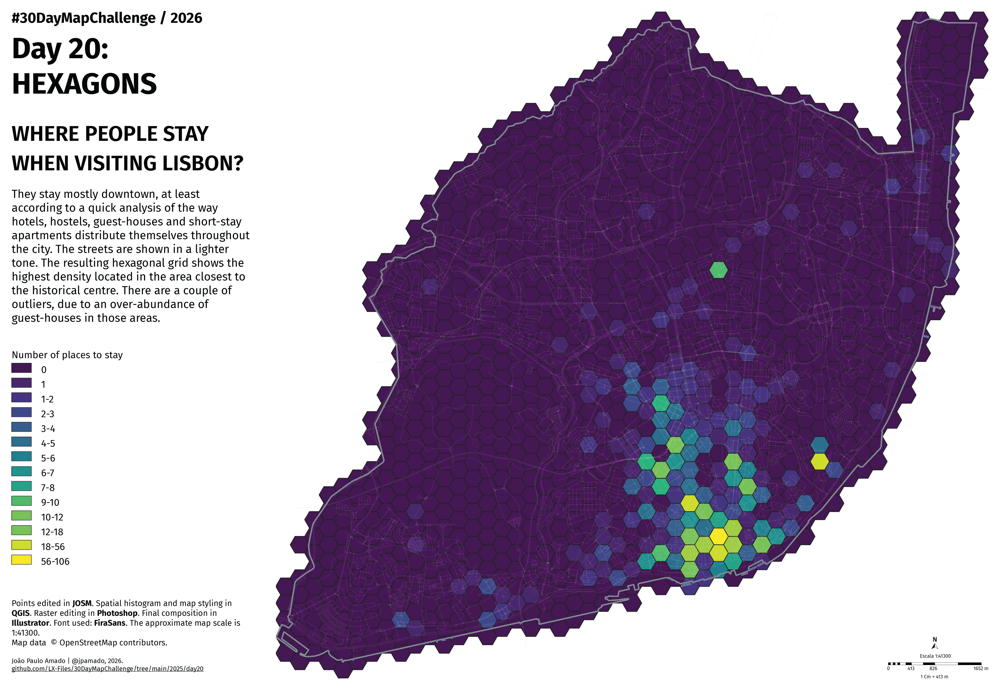

<h3>#30DayMapChallenge / 2026</h3>
<h1>DAY Day 20: HEXAGONS</h1>
<h2>WHERE PEOPLE STAY WHEN VISITING LISBON</h2>

They stay mostly downtown, at least according to a quick analysis of the way hotels, hostels, guest-houses and short-stay apartments distribute themselves throughout the city. The streets are shown in a lighter tone. The resulting hexagonal grid shows the highest density located in that area, closer to the historical centre. There are a couple of outliers, due to an over-abundance of guest-houses in those areas.

Points edited in <b>JOSM</b>. Spatial histogram and map styling in <b>QGIS</b>. Raster editing in <b>Photoshop</b>. Final composition in <b>Illustrator</b>. Font used: <b>FiraSans</b>.

Map data © OpenStreetMap contributors The approximate scale of the city plan is 1:41800.

File listing:

<ul>
<li><b>30daymapchallenge__2026-day-20__hexagons.png</b> - the MAP itself.</li>
<li>
</ul>

João Paulo Amado | @jpamado, 2026.

&nbsp;

<table>
<tr>
<td style="border:thin #000">

</td>
</tr>
</table>
