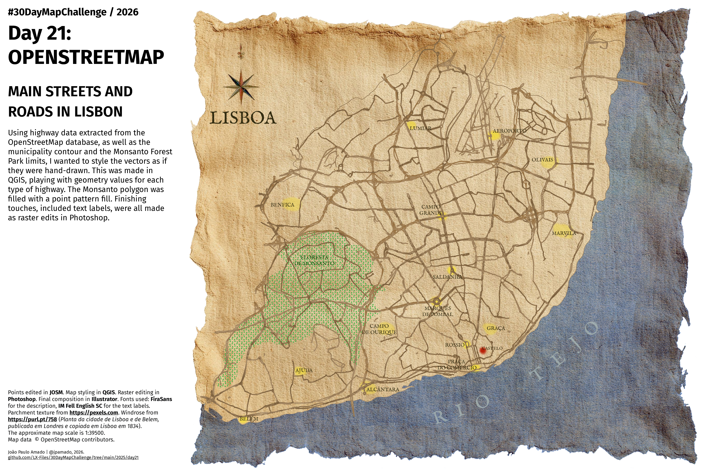

<h3>#30DayMapChallenge / 2026</h3>
<h1>DAY Day 21: OPENSTREETMAP</h1>
<h2>MAIN STREETS AND ROADS IN LISBON</h2>

Using highway data extracted from the OpenStreetMap database, as well as the municipality contour and the Monsanto Forest Park limits, I wanted to style the vectors as if they were hand-drawn. This was made in QGIS, playing with geometry values for each type of highway. The Monsanto polygon was filled with a point pattern fill. Finishing touches, included text labels, were all made as raster edits in Photoshop.

Points edited in <b>JOSM</b>. Map styling in <b>QGIS</b>. Raster editing in <b>Photoshop</b>. Final composition in <b>Illustrator</b>. Fonts used: <b>FiraSans</b> for the description, <b>IM Fell English SC for the text labels</b>. Parchment texture from <a href="https://pexels.com">https://pexels.com</a>. Windrose from <a href="https://purl.pt/758">https://purl.pt/758</a> (<i>Planta da cidade de Lisboa e de Belem, publicada em Londres e copiada em Lisboa em 1834</i>)

Map data © OpenStreetMap contributors The approximate scale of the city plan is 1:39500.

File listing:

<ul>
<li><b>30daymapchallenge__2026-day-21__openstreetmap.jpg</b> - the MAP itself.</li>
<li>
</ul>

João Paulo Amado | @jpamado, 2026.

&nbsp;

<table>
<tr>
<td style="border:thin #000">

</td>
</tr>
</table>
