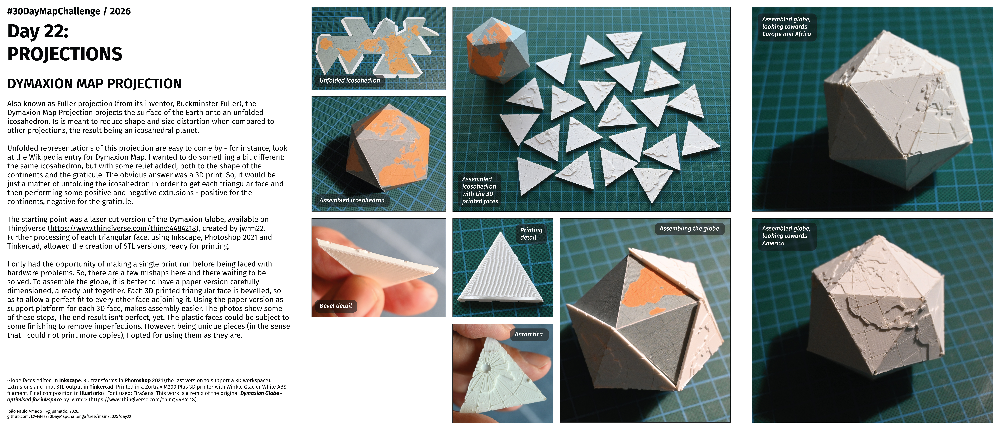

<h3>#30DayMapChallenge / 2026</h3>
<h1>DAY Day 22: PROJECTIONS</h1>
<h2>DYMAXION MAP PROJECTION</h2>

Also known as Fuller projection (from its inventor, Buckminster Fuller), the Dymaxion Map Projection projects the surface of the Earth onto an unfolded icosahedron. Is is meant to reduce shape and size distortion when compared to other projections, the result being an icosahedral planet.

Unfolded representations of this projection are easy to come by - for instance, look at the Wikipedia entry for Dymaxion Map. I wanted to do something a bit different: the same icosahedron, but with some relief added, both to the shape of the continents and the graticule. The obvious answer was a 3D print. So, it would be just a matter of unfolding the icosahedron in order to get each triangular face and then performing some positive and negative extrusions - positive for the continents, negative for the graticule.

The starting point was a lasercut version of the Dymaxion Globe, avilable on Thingiverse (<a href="https://www.thingiverse.com/thing:4484218">https://www.thingiverse.com/thing:4484218</a>), created by jwrm22. Further processing of each triangular face, using Inkscape, Photoshop 2021 and Tinkercad, allowed the creation of STL versions, ready for printing.
 

I only had the opportunity of making a single printing run before beign faced with hardware problems. So, there are a few mishaps here and there waiting to be solved. To assemble the globe it is better to have a paper version carefully dimensioned already put together. Each 3D printed triangular face is beveled, so as to allow a perfect fit to every other face adjoining it. Using the paper version as support platform for each 3D face, makes assembly easier. The photos show some of these steps, The end result isn't perfect, yet. The plastic faces could be subject to some finishing to remove imperfections. However, being unique pieces (in the sense that I could not print more copies), I opted for using them as they are. 

Globe faces edited in <b>Inkscape</b>. 3D transforms in <b>Photoshop 2021</b> (the last version to support a 3D workspace). Extrusions and final STL output in <b>Tinkercad</b>. Printed in a Zortrax M200 Plus 3D printer with Winkle Glacier White ABS filament. Final composition in <b>Illustrator</b>. Font used: <b>FiraSans</b>. This work is a remix of the original <b><i>Dymaxion Globe - optimised for inkspace</i></b> by jwrm22 (<a href="https://www.thingiverse.com/thing:4484218">https://www.thingiverse.com/thing:4484218</a>).

File listing:

<ul>
<li><b>30daymapchallenge__2026-day-22__projections.jpg</b> - the MAP itself.</li>
<li><b>dymaxion_faces.zip</b> - the STL files for printing the 20 faces.</li>
<li><b>dymaxion_map_guide.pdf</b> - triangular face layout for use as a guide.</li>
<li>
</ul>

João Paulo Amado | @jpamado, 2026.

&nbsp;

<table>
<tr>
<td style="border:thin #000">

</td>
</tr>
</table>
