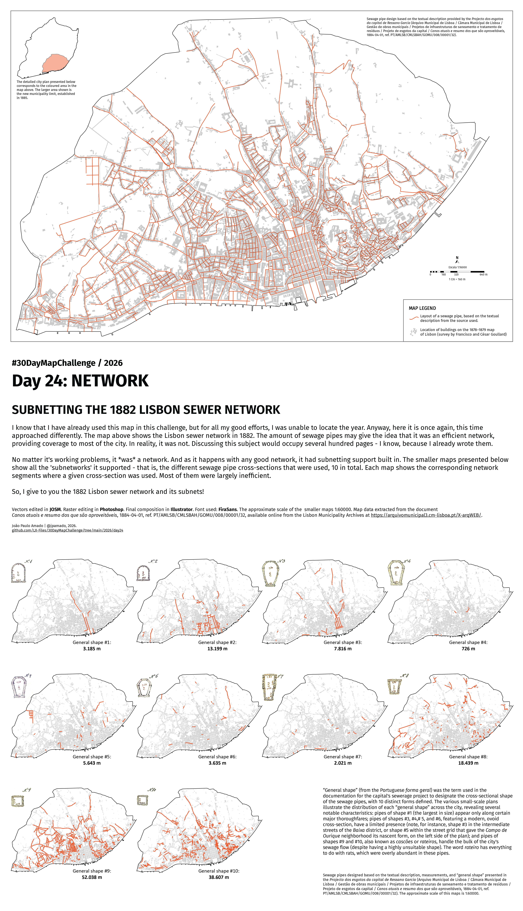

<h3>#30DayMapChallenge / 2026</h3>
<h1>DAY Day 24: NETWORK</h1>
<h2>SUBNETTING THE 1882 LISBON SEWER NETWORK</h2>

I know that I have already used this map in this challenge, but for all my good efforts, I was unable to locate the year. Anyway, here it is once again, this time approached differently. The map above shows the Lisbon sewer network in 1882. The amount of sewage pipes may give the idea that it was an efficient network, providing coverage to most of the city. In reality, it was not. Discussing this subject would occupy several hundred pages - I know, because I already wrote them.

No matter it's working problems, it *was* a network. And as it happens with any good network, it had subnetting support built in. The smaller maps presented below show all the 'subnetworks' it supported - that is, the different sewage pipe cross-sections that were used, 10 in total. Each map shows the corresponding network segments where a given cross-section was used. Most of them were largely inefficient.

So, I give to you the 1882 Lisbon sewer network and its subnets!

Vectors edited in <b>JOSM</b>. Raster editing in <b>Photoshop</b>. Final composition in <b>Illustrator</b>. Font used: <b>FiraSans</b>. The approximate scale of the  smaller maps is 1:60000.

Map data extracted from the document <i>Canos atuais e resumo dos que são aproveitáveis</i>, 1884-04-01, ref. PT/AMLSB/CMLSBAH/GOMU/008/00001/32, available online from the Lisbon Municipality Archives at <a href="https://arquivomunicipal3.cm-lisboa.pt/X-arqWEB/">https://arquivomunicipal3.cm-lisboa.pt/X-arqWEB/</a>

File listing:

<ul>
<li><b>30daymapchallenge__2026-day-24__network.png</b> - the MAP itself.</li>
</ul>

João Paulo Amado | @jpamado, 2026.

&nbsp;

<table>
<tr>
<td style="border:thin #000">

</td>
</tr>
</table>
