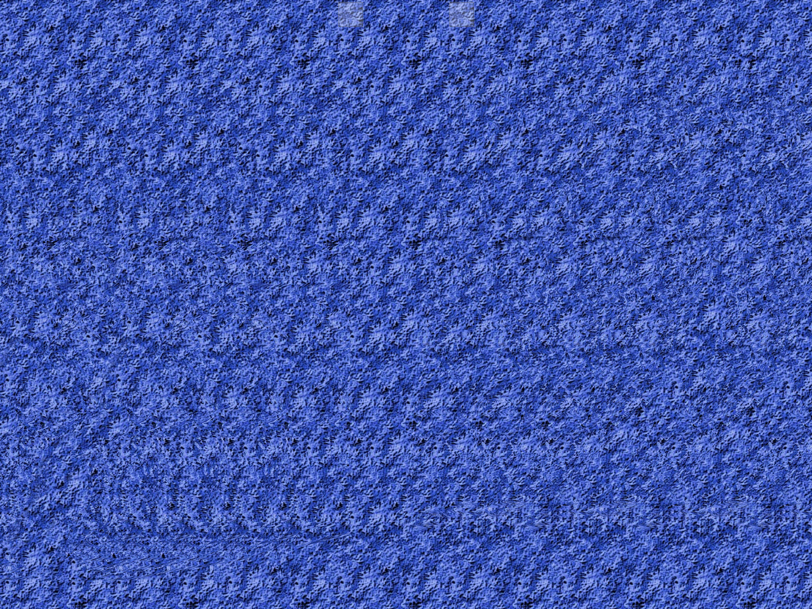

<h3>#30DayMapChallenge / 2026</h3>
<h1>DAY Day 25: IS THIS A MAP?</h1>
<h2>YES, THIS IS A MAP</h2>

From Wikipedia:

"An autostereogram is a two-dimensional (2D) image that can create the optical illusion of a three-dimensional (3D) scene. Autostereograms use only one image to accomplish the effect while normal stereograms require two. The 3D scene in an autostereogram is often unrecognizable until it is viewed properly, unlike typical stereograms [...]"

These images were all the rage in the 1990s. There is a map hidden in this autostereogram. The smaller images below show the original black and white tracing and the depth-map that was added. The result encodes a 3D-view of Lisbon, with a road grid floating over it. I hope you can see it.

Map styling in <b>QGIS</b>. The execution pipeline used <b>Inkscape</b>, <b>Photoshop 2021</b>, <b>Tinkercad</b> and <b>Sterograma</b>. Final composition in <b>Illustrator</b>. Font used: <b>FiraSans</b>. Map data © OpenStreetMap contributors.

File listing:

<ul>
<li><b>30daymapchallenge__2026-day-25__is-this-a-map.png</b> - the MAP itself.</li>
</ul>

João Paulo Amado | @jpamado, 2026.

&nbsp;

<table>
<tr>
<td style="border:thin #000">

</td>
</tr>
</table>
