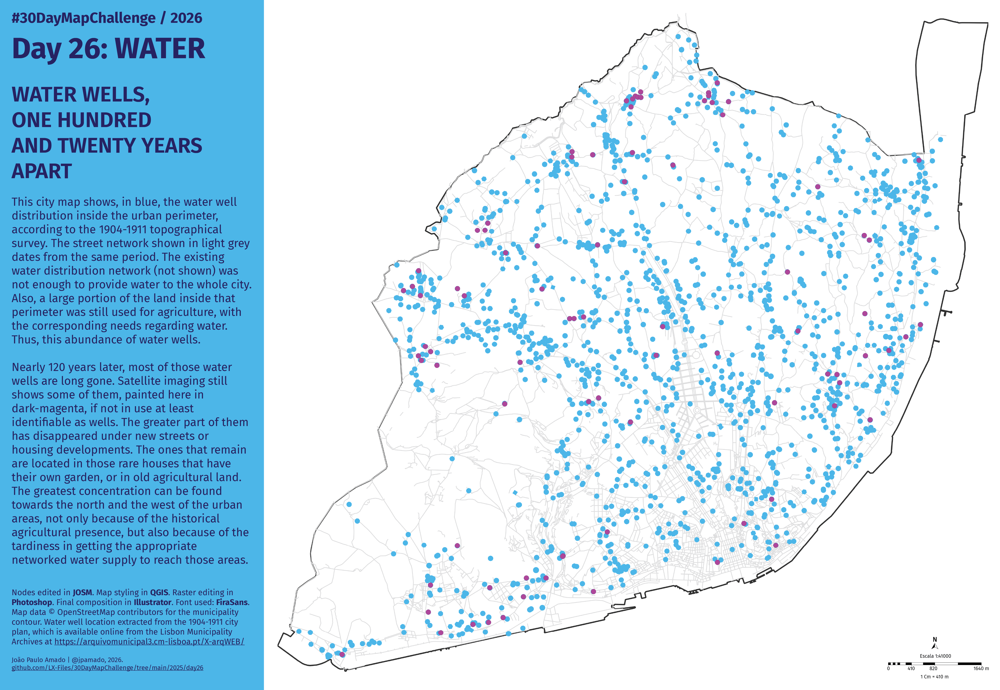

<h3>#30DayMapChallenge / 2026</h3>
<h1>DAY Day 26: WATER</h1>
<h2>WATER WELLS, ONE HUNDRED AND TWENTY YEARS APART</h2>

This city map shows, in blue, the water well distribution inside the urban perimeter, according to the 1904-1911 topographical survey. The street network shown in light grey dates from the same period. The existing water distribution network (not shown) was not enough to provide water to the whole city. Also, a large portion of the land inside that perimeter was still used for agriculture, with the corresponding needs regarding water. Thus, this abundance of water wells.

Nearly 120 years later, most of those water wells are long gone. Satellite imaging still shows some of them, painted here in dark-magenta, if not in use at least identifiable as wells. The greater part of them has disappeared under new streets or housing developments. The ones that remain are located in those rare houses that have their own garden, or in old agricultural land. The greatest concentration can be found towards the north and the west of the urban areas, not only because of the historical agricultural presence, but also because of the tardiness in getting the appropriate networked water supply to reach those areas.

Nodes edited in <b>JOSM</b>. Map styling in <b>QGIS</b>. Raster editing in <b>Photoshop</b>. Final composition in <b>Illustrator</b>. Font used: <b>FiraSans</b>. Map data © OpenStreetMap contributors for the municipality contour. Water well location extracted from the 1904-1911 city plan, which is available online from the Lisbon Municipality Archives at https://arquivomunicipal3.cm-lisboa.pt/X-arqWEB/

File listing:

<ul>
<li><b>30daymapchallenge__2026-day-26__water.png</b> - the MAP itself.</li>
</ul>

João Paulo Amado | @jpamado, 2026.

&nbsp;

<table>
<tr>
<td style="border:thin #000">

</td>
</tr>
</table>
