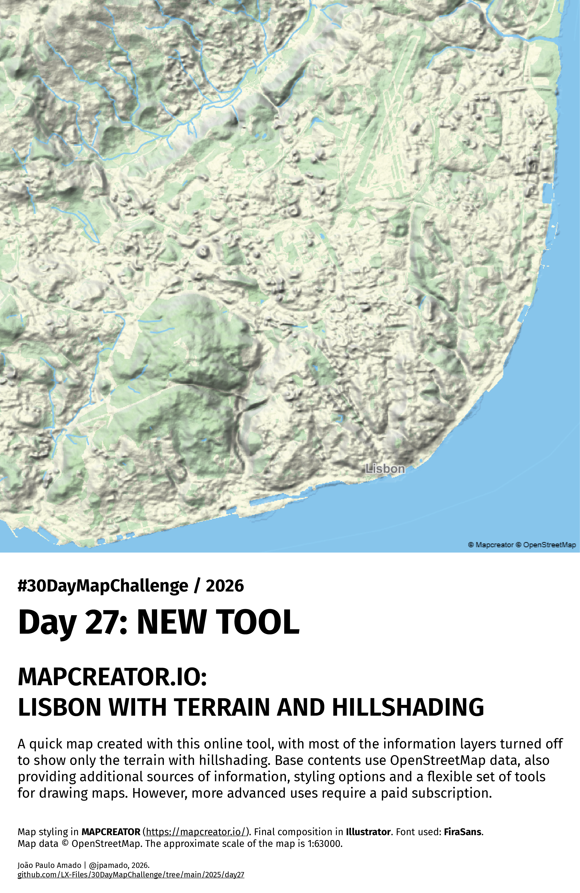

<h3>#30DayMapChallenge / 2026</h3>
<h1>DAY 27: NEW TOOL</h1>
<h2>LISBON WITH TERRAIN AND HILLSHADING</h2>

A quick map created with this online tool, with most of the information layers turned off to show only the terrain with hillshading. Base contents use OpenStreetMap data, also providing additional sources of information, styling options and a flexible set of tools for drawing maps. However, more advanced uses require a paid subscription.

Map styling in <b>MAPCREATOR</b>. Final composition in <b>Illustrator</b>. Font used: <b>FiraSans</b>. Map data © OpenStreetMap. The approximate scale of the map is 1:63000.

File listing:

<ul>
<li><b>30daymapchallenge__2026-day-27__new-tool.png</b> - the MAP itself.</li>
</ul>

João Paulo Amado | @jpamado, 2026.

&nbsp;

<table>
<tr>
<td style="border:thin #000">

</td>
</tr>
</table>
